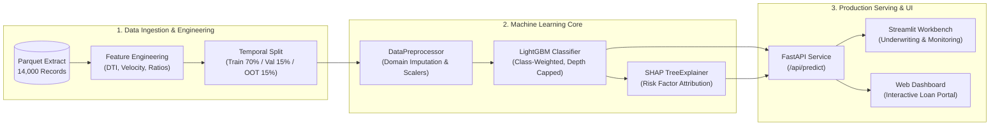

# AI-Driven Alternative Credit Scoring & Underwriting Engine

[](https://www.python.org/)
[](https://lightgbm.readthedocs.io/)
[](https://fastapi.tiangolo.com/)
[](https://streamlit.io/)
[](LICENSE)

An end-to-end, production-grade credit risk modeling and automated underwriting platform designed for **underbanked and thin-file borrowers** (students, gig-economy freelancers, micro-merchants). Built following banking-standard risk governance, State Bank of Vietnam (SBV) guidelines, and personal data protection regulations (PDPA Decree 13/2023/ND-CP).

---

## 📌 Executive Summary & Key Highlights

* **Problem Solved:** Traditional credit bureaus (e.g., CIC) lack historical data for millions of creditworthy individuals. This system engineers alternative behavioral, liquidity, and velocity proxies to assess default risk without manual paperwork.
* **Banking-Grade ML Pipeline:**
  * **Temporal (Out-of-Time) Validation:** Avoids lookahead bias by splitting strictly along temporal horizons (`disbursement_date`), simulating realistic deployment conditions.
  * **Zero Data Leakage:** Preprocessing transformations and domain imputations are fitted strictly on the training partition.
  * **Domain-Specific Imputation:** Differentiates between missing records (absence of credit card facility = `0`) and unobserved income/demographics (`train median` and `'UNKNOWN'`).
* **Strong Predictive Performance:**
  * **Out-of-Time (OOT) Test ROC-AUC:** **`0.7546`**
  * **Gini Coefficient ($2 \times \text{AUC} - 1$):** **`0.5093`** *(Standard banking threshold $> 0.40$)*
  * **Kolmogorov-Smirnov (KS) Statistic:** **`0.3978`** *(Strong risk discrimination)*
* **Model Explainability (XAI):** Built-in **SHAP (Shapley Additive exPlanations)** TreeExplainer delivering top adverse risk factors for adverse action notices and adverse action compliance.
* **Deterministic Guardrails:** Strict separation between deterministic ML scoring (LightGBM) and conversational layers—**no Large Language Model (LLM) is permitted to hallucinate or fabricate credit scores**.
* **Human-In-The-Loop (HITL):** Built-in Credit Risk Officer workbench for final facility approval and risk policy overrides.

---

## 🏛️ System Architecture



---

## 📂 Project Structure

```text
credit-default-classifier/
├── configs/                     # Hyperparameters and environment configurations
├── data/
│   ├── raw/                     # Raw loan origination files
│   └── processed/               # Cleaned parquet datasets (14,000 samples x 88 features)
├── docs/                        # Domain specifications & documentation
│   ├── 01_business_requirements.md  # Business requirements document (BRD)
│   ├── 02_data_dictionary.md        # Feature definitions and banking schemas
│   └── 03_model_design_spec.md      # Model governance, validation, and calibration
├── models/                      # Serialized artifacts (model.joblib, preprocessor.joblib)
├── notebooks/                   # Prototyping & exploratory analysis
│   ├── 01_data_exploration.ipynb
│   └── 02_feature_engineering_and_modeling.ipynb
├── src/                         # Modular production source code
│   ├── api/
│   │   ├── app.py               # FastAPI REST microservice
│   │   └── schemas.py           # Pydantic request/response validation schemas
│   ├── components/
│   │   ├── data_loader.py       # Data extraction and parsing utilities
│   │   ├── preprocessor.py      # Domain imputation, outlier capping, encoders
│   │   └── trainer.py           # LightGBM training, Gini/KS metrics, SHAP attribution
│   ├── pipeline.py              # CLI training pipeline orchestrator
│   └── predict.py               # Real-time scoring and inference engine
├── ui/                          # Frontend interfaces
│   ├── app_ui.py                # Streamlit Underwriting & Monitoring Workbench
│   └── web/                     # Lightweight HTML/CSS/JS web dashboard
├── Dockerfile                   # Production container definition
├── docker-compose.yaml          # Multi-container orchestration
└── requirements.txt             # Project dependencies
```

---

## 🚀 Quick Start & Installation

### 1. Prerequisites
* Python 3.11+
* Git

### 2. Environment Setup
```bash
# Clone the repository
git clone https://github.com/your-username/credit-default-classifier.git
cd credit-default-classifier

# Create and activate virtual environment
python -m venv .venv

# On Windows (PowerShell):
.venv\Scripts\Activate.ps1
# On Linux/macOS:
source .venv/bin/activate

# Install dependencies
pip install -r requirements.txt
```

### 3. Run End-to-End Training Pipeline
Execute the production training pipeline to process data, perform temporal validation, train the LightGBM model, evaluate metrics, and serialize artifacts:

```bash
python -m src.pipeline
```

### 4. Launch FastAPI REST Service
```bash
uvicorn src.api.app:app --host 0.0.0.0 --port 8000 --reload
```
* **API Documentation (Swagger UI):** `http://localhost:8000/docs`
* **Health Check:** `http://localhost:8000/health`

### 5. Launch Streamlit Underwriting Workbench
```bash
streamlit run ui/app_ui.py
```
* Access the interactive dashboard at `http://localhost:8501` to score loan applications, view SHAP risk gauges, run batch evaluations, and inspect model health metrics.

---

## 📊 Benchmark Results

| Metric | Target / Benchmark | Test (OOT) Performance | Status |
| :--- | :---: | :---: | :---: |
| **ROC-AUC** | $\ge 0.70$ | **`0.7546`** |  Passed |
| **Gini Coefficient** | $\ge 0.40$ | **`0.5093`** |  Passed |
| **KS Statistic** | $\ge 0.30$ | **`0.3978`** |  Passed |
| **Data Leakage Check** | 0 features | **0 leakages detected** |  Passed |

---

## ⚖️ Compliance & Responsible AI

* **Personal Data Protection (PDPA):** All personal identifying records are pseudonymized. No PII is ingested during training.
* **Fair Lending & Bias Prevention:** Protected demographic attributes (e.g., `gender`, `province`) are monitored to ensure unbiased decisioning across demographic segments.
* **No Black-Box Decisions:** Each credit application response returns the top 3 contributing positive factors and top 3 negative factors with exact numerical impact.

---

## 👤 Author
Developed as an enterprise-grade Machine Learning Engineering project for alternative credit risk assessment. For inquiries or collaboration, please reach out via GitHub or LinkedIn.
