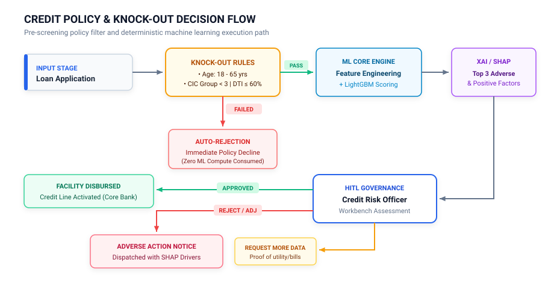
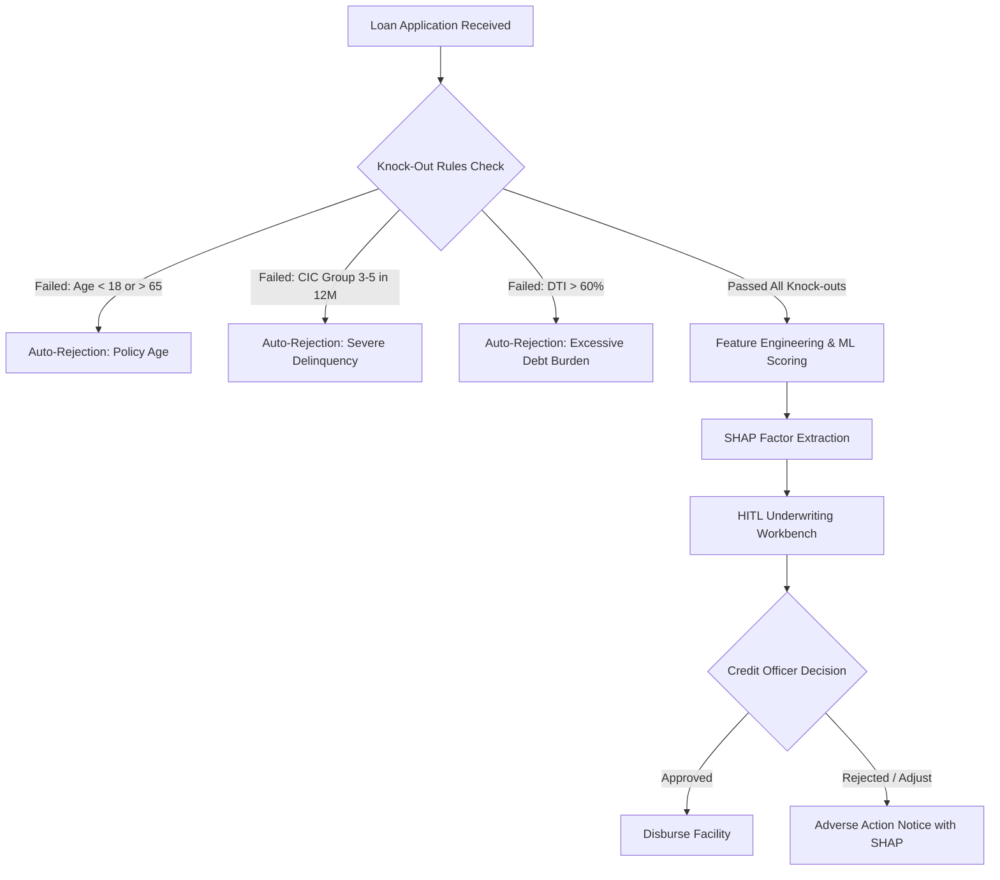
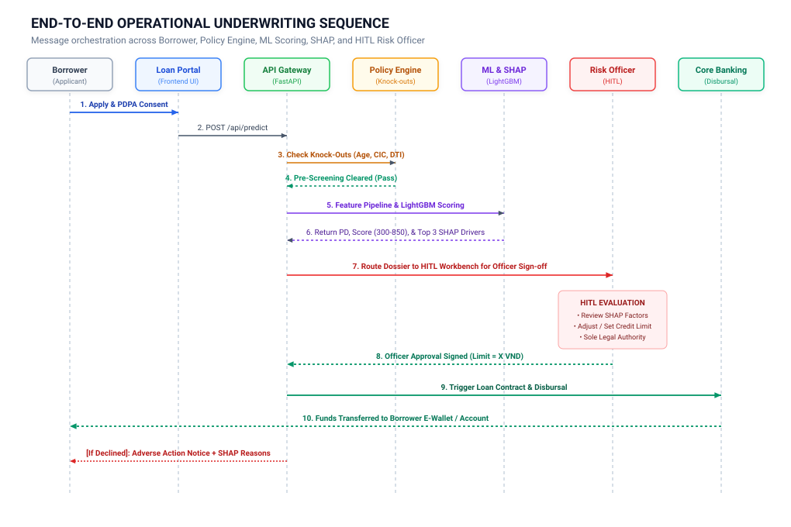
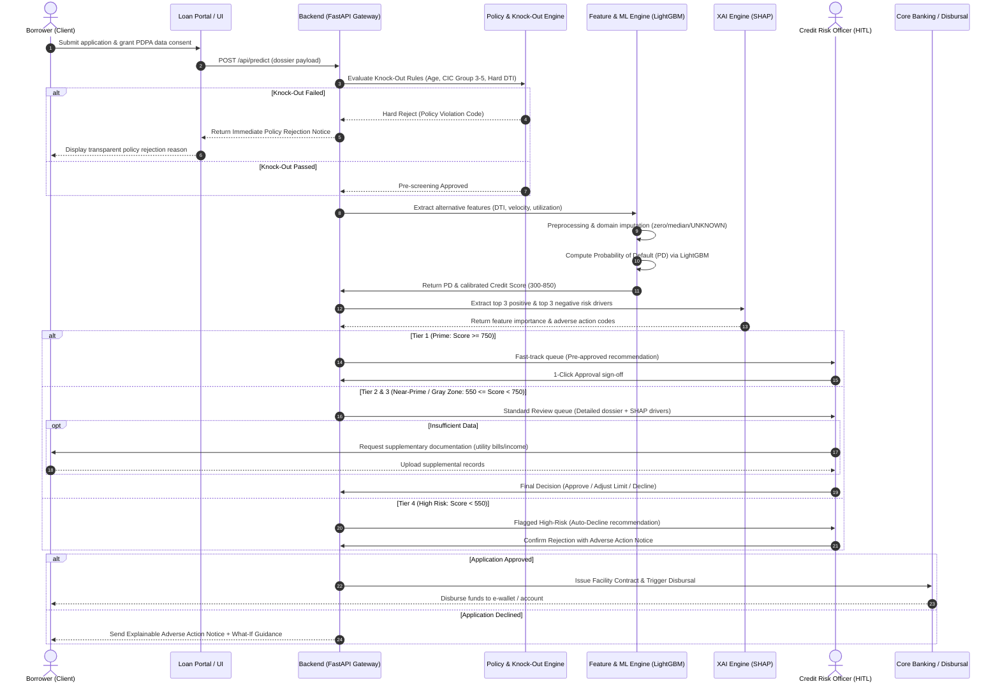
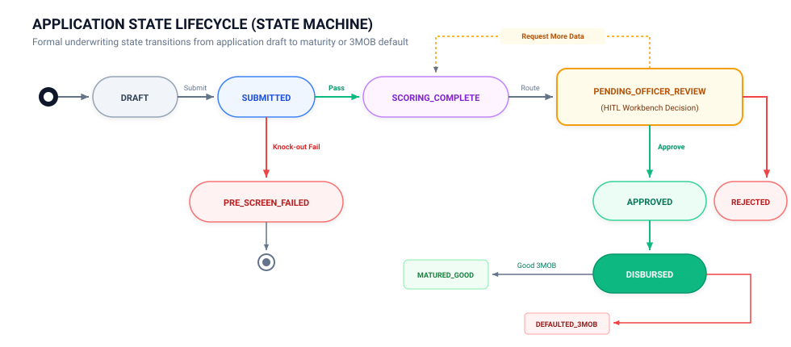
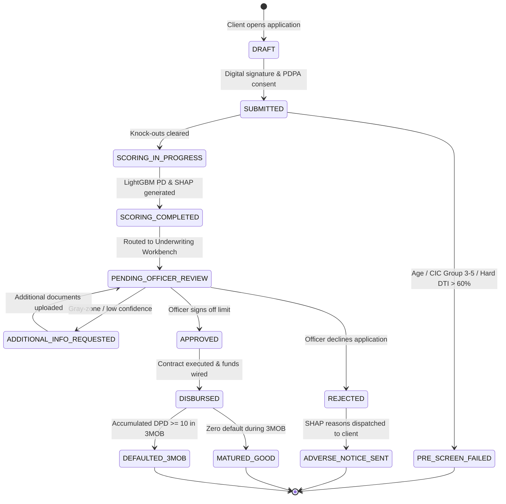

# Business Requirements Document (BRD)
## Alternative Credit Scoring & Underwriting System (FIN-04)

---

### 1. Executive Summary & Problem Statement

#### 1.1 Context
In emerging markets like Vietnam, a vast segment of the population—including university students, gig economy workers (ride-hailing drivers, freelance creators), and micro-merchants—remains **unbanked or underbanked** ("thin-file" borrowers). 

Traditional commercial banks rely heavily on:
* Formal payroll records and bank statements
* Indefinite labor contracts
* Established credit bureau (CIC - Credit Information Center) footprints

As a consequence, creditworthy individuals with non-traditional income streams are systematically excluded from prime consumer loans, forcing them toward predatory loan sharks or high-cost peer-to-peer lending platforms.

#### 1.2 Objective
To build an **AI-Driven Alternative Credit Scoring & Decisioning Platform** that leverages non-traditional behavioral proxies—such as e-wallet transaction patterns, utility bill settlement consistency, cash flow liquidity, and short-term debt velocity—to accurately assess borrower default risk, recommend customized credit limits, and deliver auditable explanations.

---

### 2. Regulatory & Compliance Constraints

In compliance with directives from the **State Bank of Vietnam (SBV)** and national data privacy standards:

| Regulatory Pillar | Requirement & Implementation |
| :--- | :--- |
| **Decree 13/2023/ND-CP (PDPA)** | Strict Personal Data Protection. Borrower consent is mandatory prior to gathering behavioral and CIC data. |
| **SBV Consumer Lending Regulations** | Transparent interest rates, capped loan tenures, and anti-usury guardrails. |
| **Anti-Hallucination & Determinism** | **STRICT MANDATE:** Credit scores and default probabilities must be derived exclusively from deterministic ML models (e.g., LightGBM) and mathematical formulas. Large Language Models (LLMs) are **strictly forbidden** from generating or altering numerical scores. |
| **Model Explainability (XAI)** | No "black box" decisions. Every rejected applicant or limited credit line must be accompanied by top actionable adverse factors derived via SHAP (Shapley Additive exPlanations). |
| **Human-In-The-Loop (HITL)** | Autonomous AI agents may only propose credit limits. Final loan approval and credit limit modifications **mandatorily require** sign-off by a certified Credit Risk Officer. |
| **Fair Lending & Anti-Bias** | Demographic protected attributes (such as `gender` and geographic `province`) must not be used as discriminatory punitive weights. |

---

### 3. Target Definition & Risk Horizon

#### 3.1 Target Variable: `DPD10_3MOB`
The target variable is defined as **Days Past Due $\ge 10$ days within the first 3 Months On Books**:
$$\text{Target} = \begin{cases} 1 & \text{if borrower accumulates } \ge 10 \text{ consecutive days past due within 90 days post-disbursement} \\ 0 & \text{otherwise (Good payer)} \end{cases}$$

#### 3.2 Business Rationale for 3MOB Early Default
1. **Early First Payment Default (FPD):** Defaulting within the first 90 days is a primary indicator of first-party fraud, synthetic identity, or immediate severe liquidity insolvency.
2. **Actionable Velocity:** 3-month performance windows allow financial institutions to retrain underwriting scorecards rapidly without waiting 12–24 months for vintage maturation.
3. **10-Day Grace Threshold:** Distinguishes technical delays (e.g., weekend bank transfer processing or forgotten due dates) from genuine credit distress.

---

### 4. Credit Policy Rules & Knock-Out Filters

Before any record is submitted to the machine learning inference engine, it must pass through deterministic business policy rules (Knock-Out Filters):

<b>View Mermaid Source Code</b>

#### Knock-out Criteria:
1. **Age Constraints:** Applicant age must satisfy $18 \le \text{Age} \le 65$.
2. **Severe Delinquency Record:** Any CIC record classified in debt groups 3, 4, or 5 within the past 12 months (`cic_max_group_12m >= 3`) results in immediate auto-rejection.
3. **Debt-to-Income (DTI) Hard Cap:** Calculated as:
   $$\text{DTI} = \frac{\text{Total Monthly Debt Service Obligations}}{\text{Declared Monthly Net Income}}$$
   If $\text{DTI} > 60\%$, the application is auto-rejected due to over-indebtedness.

---

### 5. Credit Scoring Bands & Decision Matrix

Probabilities of Default ($PD \in [0, 1]$) predicted by the LightGBM model are calibrated to standard credit score bands:

$$\text{Credit Score} = 850 - (PD \times 550)$$

| Risk Tier | Score Range | Default Risk ($PD$) | Policy Action | Maximum Facility Recommended |
| :---: | :---: | :---: | :---: | :---: |
| **Tier 1 (Prime)** | 750 – 850 | $< 5\%$ | Fast-Track Approval | Up to 100,000,000 VND |
| **Tier 2 (Near-Prime)** | 650 – 749 | $5\% - 15\%$ | Standard Review | Up to 50,000,000 VND |
| **Tier 3 (Subprime / Gray)** | 550 – 649 | $15\% - 30\%$ | Enhanced Due Diligence (EDD) | Up to 20,000,000 VND |
| **Tier 4 (High Risk)** | $< 550$ | $> 30\%$ | Auto-Decline | 0 VND |

---

### 6. End-to-End Operational Workflow & HITL Governance

#### 6.1 End-to-End Workflow Sequence Diagram
The interaction across borrowers, automated microservices, risk rule engines, ML inference pipelines, and Human-in-the-Loop credit risk officers is defined below:

<b>View Mermaid Source Code</b>

---

#### 6.2 Detailed Stage-by-Stage Operational Walkthrough

| Stage | Operational Phase | Owner / Component | Key Actions & Business Logic |
| :---: | :--- | :--- | :--- |
| **01** | **Customer Onboarding & Consent** | Borrower / UI | Applicant submits loan application, declared income, and signs digital PDPA Decree 13/2023 consent to allow alternative data querying. |
| **02** | **Deterministic Pre-Screening** | Policy Rule Engine | Fast-fails high-risk applicants before consuming ML compute: checks age boundaries ($18 \le \text{Age} \le 65$), prior CIC delinquency (`cic_max_group_12m < 3`), and hard debt-to-income limits ($DTI \le 60\%$). |
| **03** | **Alternative Feature Engineering** | Preprocessor Pipeline | Synthesizes behavioral indicators: DTI, non-bank loan ratios, credit card utilization, inquiry velocity, and recent balance trends ($M_1$ vs $M_3$). |
| **04** | **Deterministic Model Scoring** | LightGBM Core | Calculates calibrated Probability of Default ($PD$). Maps $PD$ into credit score bands ($300 - 850$) and determines baseline credit line limit. |
| **05** | **XAI Factor Attribution** | SHAP Engine | Generates local Shapley values identifying the top 3 protective factors (e.g., stable balance, no delinquency) and top 3 adverse risk drivers (e.g., high non-bank ratio, recent inquiries). |
| **06** | **HITL Underwriting Governance** | Credit Risk Officer | Officer inspects the dossier on the Underwriting Workbench. Officer retains sole legal authority to endorse, adjust limits downwards/upwards, or request additional data. |
| **07** | **Post-Disbursement Vintage Tracking** | Portfolio Risk Monitoring | Disbursed loans enter vintage tracking for $90$ days to measure `DPD10_3MOB`. Out-of-time performance metrics feed automated drift monitoring and retraining pipelines. |

---

#### 6.3 Application State Lifecycle (State Machine)

The lifecycle of each loan application is governed by strict state transitions:

<b>View Mermaid Source Code</b>

